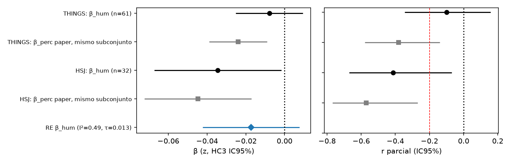

# Resultados: comparación con datos humanos públicos (Open Mind #2796)

- Plan congelado: `plan_analisis_datos_humanos_FROZEN_2026-10-30.md`, sha256 `9b50995eb5e8d2d30e8a9e5e13b56f7a3e8596ecea0a01fd2d833eeb67baac6c` (PLAN_HASH.txt, 2026-10-30 10:13 hora de Santiago). Re-verificado; no se modificó.
- Desviaciones: `DESVIACIONES.md`. Código: `human_data_analyses/scripts/` (semilla 42). Resultados crudos: `human_data_analyses/out/*.json|txt`.
- Los veredictos aplican literalmente las reglas del plan; no se interpretan más allá.

> **Los datos humanos son secundarios:** provienen de experimentos realizados por otros equipos (THINGS, ImageNet-HSJ, CIFAR-10H, Lewis & Frank 2018, normas Glasgow), con tareas, estímulos y participantes distintos; nosotros no corrimos esos experimentos. Las diferencias entre fuentes se reportan como tales y no se ajustaron.

## Tabla resumen

| Hipótesis | Fuente | Estimación clave | Regla | Veredicto |
|---|---|---|---|---|
| H1 | THINGS (3.400 pares) | ρ = .523 [.496, .549]; Mantel p Holm = .0005 | ρ>0 y p Holm<.05 | **Apoyo** |
| H1 | HSJ (1.390 pares) | ρ = .501 [.456, .543]; p Holm = .0005 | idem | **Apoyo** |
| H1 | CIFAR-10H (45 pares) | ρ = .795 [.606, .897]; p Holm = .0005 | idem | **Apoyo** |
| H2 | THINGS (n=61) | β_hum = −.0079, p Holm = .374; r parcial −.100 [−.345, .158] | IC incluye 0 y −.20 | **Inconcluso** |
| H2 | HSJ (n=32) | β_hum = −.0344, p = .039, p Holm = .079; r parcial −.413 [−.670, −.069]; β_sem p = .362 | ninguna regla se cumple | **Inconcluso (fuera de reglas; ver DESVIACIONES §7)** |
| H3 | tiers CIFAR-10 (descriptivo) | ver tabla H3 | sin inferencia | Descriptivo |
| H4 | Lewis & Frank 2018 (520 personas, 600 participaciones, 172.800 obs.) | log OR por DE de dist = −3.23 [−3.29, −3.16], p Holm < .001 (corregido 31-oct: RE por persona, DESV §26) | β<0 y p Holm<.05 | **Apoyo** |
| H5 | Glasgow AoA vs coherencia de clase (exploratorio) | C100 n=85: ρ parcial −.110 [−.317, .107], p=.320, p BH=.320; C10 n=10: ρ parcial −.891 [−.977, −.555], p=.0013, p BH=.0026 | BH; sin regla de veredicto en el plan | Exploratorio (sin veredicto) |
| H6 | CVCL (no humano), CIFAR-10 y CIFAR-100 | (a) OLS c100 n=100: β_perc_CVCL = +.0047 [−.018, .028], p=.688, p BH=.688; β_sem = −.0059 [−.029, .017], p=.617; (b) ρ CVCL–DINOv2 c100 = .618 [.599, .636], c10 = .751; (c) c100 vs THINGS .683, HSJ .429; c10 vs THINGS .859, HSJ .637, C10H .786 (todas p BH ≤ .0042) | Consistente exige β_perc<0 con IC sin 0 tras BH | **Inconsistente** (IC de β_perc_CVCL incluye 0) |

Holm sobre 6 pruebas: `out/holm_confirmatory.json`. p sin corregir: H1 (las 3) = .0001 (Mantel, mínimo por 10.000 permutaciones); H2 THINGS .374; H2 HSJ .039; H4 < .001.

Figuras: `figs/forest_h2.png` (forest H2/§4), `figs/bland_altman.png` (Bland–Altman §4).

## H1. Acuerdo d_perc (DINOv2) vs distancias humanas
Bootstrap de pares 10.000 (semilla 42), Mantel 10.000 permutaciones. Descriptivo en CIFAR-10: THINGS ρ = .696 (45 pares), HSJ ρ = .723 (35).

## H2. acc_pair ~ z(d_hum) + z(d_sem) (OLS, HC3)

| Fuente | n | β_hum | p | r parcial [IC95] | β_sem p | R² |
|---|---|---|---|---|---|---|
| THINGS | 61 | −.0079 | .374 | −.100 [−.345, .158] | .211 | .106 |
| HSJ | 32 | −.0344 | .039 | −.413 [−.670, −.069] | .362 | .185 |

H2b (descriptivo, d_perc + d_hum + d_sem en el mismo subconjunto): THINGS β_perc −.0236 (p .0036), β_things p .77; HSJ β_perc −.0421 (p .0032), β_hsj −.0304 (p .054), β_sem +.0293 (p .049). Diferencia β_perc − β_hum: THINGS −.0212 [−.0448, .0023]; HSJ −.0117 [−.048, .027]. Robusteces en `out/h1_h2_results.json` (H2_rob): con d_sem del mapeo WordNet original (manteniendo el mapeo THINGS primario) THINGS β_hum p = .045; con el mapeo THINGS del scouting p = .542 (n=59), estricto p = .372 (n=55) [etiqueta corregida 2026-10-31, DESVIACIONES §23]; HSJ p entre .006 y .064 según umbral/mapeo.

## H3. Tiers CIFAR-10 (descriptivo, sin inferencia)

| Distancia | n tiers | ρ(acc_tier, d) [IC bootstrap] |
|---|---|---|
| d_perc (DINOv2) | 10 | −.770 [−.958, −.272] |
| d_sem | 10 | −.769 [−.991, −.127] |
| d_things | 10 | −.685 [−.887, −.082] |
| d_hsj | 7 | −.750 [−1.00, .176] |
| d_c10h | 10 | −.818 [−.988, −.274] |

Complemento por imagen (10.000 imágenes de test CIFAR-10H): ρ(entropía humana, margen del aprendiz) = .391 [.374, .409]; margen = d(centroide propio) − d(rival más cercano), es decir, mayor margen = más ambiguo para el aprendiz. Precisión centroide 94,6 %; mayoría humana 99,2 %.

## H4. GLMM selección ~ z(dist) + level + condition + (1+z(dist)|persona) + (1|imagen)
**Corrección (31-oct-2026, DESVIACIONES §26):** el subid de XTMEM identifica a la persona en los 12 experimentos (600 participaciones, 520 personas). La versión anterior agrupaba por exp_subid (600 "sujetos"); se conserva abajo como registro. La pendiente aleatoria convergió sin advertencias en todos los ajustes (`scripts/04c_h4_person_re.R`, `out/h4_person_re.txt`).

| Especificación (RE por persona) | n | personas | log OR z(dist) [IC95 Wald] |
|---|---|---|---|
| **Primaria (24 ítems)** | 172.800 | 520 | **−3.23 [−3.29, −3.16]** |
| + (1\|participación) | 172.800 | 520 | −3.23 [−3.30, −3.17] |
| Solo la primera participación (primera sesión real por AcceptTime; DESV §29) | 149.760 | 520 | −3.17 [−3.23, −3.10] |
| Excluye a quienes repiten | 133.632 | 464 | −3.12 [−3.19, −3.05] |
| Sin exp. no prerregistrados (8, 12) | 144.000 | 444 | −3.17 [−3.24, −3.10] |
| 8 ítems objetivo (con nivel y condición) | 57.600 | 520 | −3.16 [−3.30, −3.02] |
| 8 objetivo, primera participación (primera sesión real; DESV §29) | 49.920 | 520 | −3.12 [−3.26, −2.97] |
| 8 objetivo, excluye a quienes repiten | 44.544 | 464 | −3.11 [−3.26, −2.96] |

En todos, p < 10⁻¹⁰⁰. La regla de apoyo se mantiene: **Apoyo**.

Versión anterior de C3/C7 ("primera" = experimento de menor número; sustituida 31-oct, DESV §29): −3.18 [−3.25, −3.12] y −3.11 [−3.26, −2.97]. `scripts/04d_h4_firstsession_interaction.R`, `out/h4_firstsession_interaction.txt`.

Versión anterior (agrupada por exp_subid; sustituida): primaria −3.23 [−3.29, −3.17]; sin no prerregistrados −3.17 [−3.24, −3.11]; ítems objetivo −3.19 [−3.33, −3.05].

Interacción dist × condición (exploratoria; sigue agrupada por exp_subid, no se re-estimó, Wald; LR falló, DESVIACIONES §19): zd = −2.93 (ref.); zd×sub +0.10 (z=3.47); zd×bas −0.87 (z=−22.05); zd×sup −1.30 (z=−36.24).

## §4. Desviación entre fuentes
- Acuerdo: c100 THINGS–HSJ ρ = .597 [.553, .636] (1.042 pares; 20 muestreados); c10 THINGS–HSJ .734, THINGS–C10H .779, HSJ–C10H .734 (Mantel p ≤ .001).
- Forest plot: `figs/forest_h2.png`. Rango β_hum: −.034 a −.008. Efectos aleatorios (descriptivo, k=2, fuentes no independientes): β_RE = −.017 [−.042, .008], I² = .49, τ = .013; r parcial (Fisher z) I² = .54, τ = .18.
- Modelos combinados: (a) z compuesto sobre la unión (n=73): β = −.018, p = .080, β_sem p = .85; (b) formato largo, interacción z(d_hum) × fuente: LR = 0.94, p = .33 (OLS, ver DESVIACIONES §16); (c) intersección (n=20): compuesto β = −.066, p = .005 (β_sem +.035, p = .028); THINGS solo p = .86; HSJ solo β = −.054, p = .002.
- Bland–Altman (`figs/bland_altman.png`), Δ = z(d_hum) − z(d_perc): DE Δ THINGS .89 (3.400), HSJ .97 (1.390), CIFAR-10H .50 (45). Top-10 |Δ|: THINGS boy–girl, otter–seal, dolphin–whale, orchid–sunflower, beaver–otter, cup–lamp, oak–pine, pine–willow, girl–woman, maple–pine; HSJ dolphin–table, keyboard–tiger, cattle–pickup_truck, cattle–telephone, orchid–sweet_pepper, orchid–snail, camel–hamster, bicycle–mountain, hamster–porcupine, leopard–tiger; CIFAR-10H bird–deer, cat–dog, dog–frog, bird–dog, deer–horse, airplane–ship, cat–deer, frog–truck, frog–horse, automobile–ship (valores en `out/dispersion_results.json`).

## H5. Exploratorio (BH dentro de H5)
Coherencia de clase DINOv2 vs AoA Glasgow, Spearman parcial controlando log-frecuencia (`out/h5_results.json`): CIFAR-100 n=85, ρ parcial −.110 [−.317, .107], p=.320 (BH .320), ρ cruda .022; CIFAR-10 n=10, ρ parcial −.891 [−.977, −.555], p=.0013 (BH .0026), ρ cruda −.596. Wordbank no corrido (Redivis con login); sobreextensiones no corridas (licencia). El plan no define regla de veredicto para H5.

## H6. CVCL (no es dato humano; control exploratorio)
Completo el 2026-10-30 ~18:05 hora de Santiago (`out/h6_results.json`, complete=true; versión parcial previa en `out/h6_results_partial_c10only.json`). BH dentro de H6 sobre 9 pruebas: (a) β_perc y β_sem; (b) c10 y c100; (c) c10 ×3 y c100 ×2 (DESVIACIONES §21).

- **(a) OLS HC3 en CIFAR-100** (mismos 100 pares, mismo aprendiz por centroides, 30 episodios 3-way 5-shot), `acc_pair_CVCL ~ z(d_perc_CVCL) + z(d_sem)`, R² = .003: β_perc_CVCL = +.0047, EE .0117, IC 95 % [−.018, .028], p = .688, p BH = .688, r parcial .043 [−.156, .238]; β_sem = −.0059, EE .0117, IC [−.029, .017], p = .617, p BH = .688, r parcial −.053 [−.248, .146].
- **Precisión base del aprendiz** (riesgo 1 del plan): media acc_pair c100 con CVCL = .618; con DINOv2 (paper) = .850.
- **(b) d_perc CVCL vs DINOv2**: CIFAR-100, 4.950 pares, ρ = .618 [.599, .636], Mantel p = .0001, p BH = .0002; CIFAR-10, 45 pares, ρ = .751 [.536, .874], p BH = .0002.
- **(c) CVCL vs distancias humanas**: CIFAR-100 THINGS (3.400 pares) ρ = .683 [.663, .700], p BH = .0002; HSJ (1.390 pares) ρ = .429 [.384, .471], p BH = .0002. CIFAR-10: THINGS .859 [.756, .914], HSJ .637 [.404, .782], C10H .786 [.593, .892] (p BH ≤ .0042; DINOv2 ref.: .696, .723, .795).
- **(d) Tiers CIFAR-10** (descriptivo): precisión c1 CVCL native .675 / near .647 / mid .511 / far .428 (DINOv2 .943/.847/.654/.530); ρ(acc, d_perc CVCL) = −.842 [−.963, −.425].
- **Veredicto según la regla del plan: Inconsistente**, porque el IC 95 % de β_perc_CVCL incluye 0. Según el plan, ningún resultado de H6 sustituye ni corrige los análisis confirmatorios.

### H4 exploratorio: distancia × condición, RE por persona (31-oct-2026, DESV §32)
Ref. condición "1 ejemplo": pendiente zd −2.92 [−3.00, −2.85]. Interacciones: ×3 sub +0.10 [0.04, 0.16] (z = 3.44); ×3 básicos −0.86 [−0.94, −0.79] (z = −21.9); ×3 superordinados −1.29 [−1.36, −1.22] (z = −36.1). LR χ²(3) = 2134, p < .001. La pendiente de distancia cambia según la condición de enseñanza; exploratorio. `out/h4_interaction_person.txt`.
